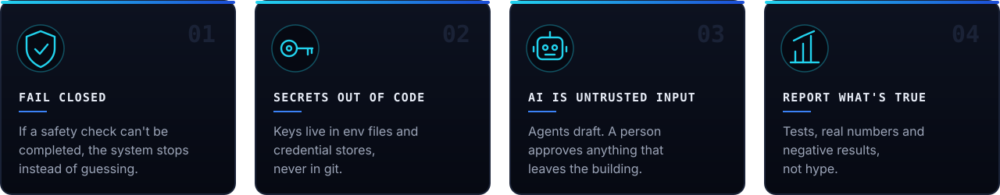

  

  

  
  

## `> whoami`

  

## `> featured_builds`

  
  

Coming next: a self-hosted outreach platform where the database enforces consent and AI replies wait for a human.

## `> toolbox`

  
  
  
  
  
  
  
  
  
  
  
  

  
  
  
  
  
  
  
  
  

## `> how_i_build`

  

<code>building in public from Johannesburg 🇿🇦</code>

